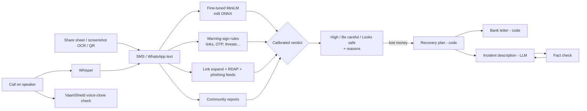

# Kavach (कवच) — AI scam-message detector and recovery agent

> *Kavach* = armour. Paste a suspicious SMS or WhatsApp message (English, हिंदी, मराठी, Hinglish) and Kavach
> tells you if it's a scam, **why**, and, if you've already lost money, **exactly what to do in the next hour**.

**Live demo:** {{WEB_URL}} · **API:** {{API_URL}}/docs · **Model:** [huggingface.co/shravan37/kavach-scam-classifier](https://huggingface.co/shravan37/kavach-scam-classifier) · Built by [Shravan Kasar](https://github.com/shravankasar37)

Part of an AI-safety suite: call recordings are checked by **[VaaniShield](https://github.com/shravankasar37/VaaniShield2.0)**
(voice-clone detection) and FIR complaints are drafted by **[NyayaSathi](https://github.com/shravankasar37/-NyayaSathi)**
(agentic legal aid).

---

## The problem

Fake KYC updates, "your electricity will be cut tonight", "your parcel is held", part-time "task" jobs and
"digital arrest" calls reach millions of Indians every day. Victims, often elderly or first-time smartphone users,
can't tell a fake from a real bank message, and after losing money they lose the most valuable hours not knowing
that a call to **1930** can freeze the money if it's made fast.

## What Kavach does

Built so that a parent who has never copy-pasted anything can use it:

| Situation | What Kavach does |
|---|---|
| A suspicious SMS / WhatsApp message | Long-press → **Share → Kavach** (installable app, Web Share Target), or paste it. Verdict + reasons in **English, हिंदी or मराठी**, with a **🔊 read-aloud** button |
| A scam **screenshot** forwarded on a family group | Read on the phone with OCR (English + Hindi + Marathi); the image never leaves the device |
| A short or unknown link | **Follows redirects** (bit.ly → real site), shows the **domain's age** (RDAP) and checks **OpenPhish + URLhaus** phishing/malware feeds |
| "Scan this QR to get your refund" | Decodes the **QR / UPI** request and says plainly: *scanning this SENDS ₹4,999 to 98xxx@ybl*; flags a brand name hiding behind a personal UPI ID |
| A "digital arrest" / fake-police **call** | **Call Guard**: listens on speaker (or takes a recording / WhatsApp voice note), transcribes with Whisper, catches "safe account", "don't tell your family", "video-call arrest" scripts → **"Hang up now"**, and checks the voice for AI cloning via [VaaniShield](https://github.com/shravankasar37/VaaniShield2.0) |
| "Is this number a scammer?" | **Community reports** + lookup. Numbers/UPI IDs are stored only as salted hashes; one counts as reported only after **3 different people** report it |
| Money already lost | A plan decided by code (**1930 first**, cybercrime.gov.in, block UPI/card, Sanchar Saathi, RBI's 3-working-day zero-liability rule), a bank letter citing RBI circular DBR.No.Leg.BC.78/09.07.005/2017-18, and an incident description drafted by an LLM **from the user's own facts only**, then fact-checked |
| New scam scripts | Reports warn everyone instantly; [`scripts/export_reports.py`](scripts/export_reports.py) turns reports confirmed by 3+ people into training rows for the next fine-tune |
| On Telegram | Forward a message to the bot; it answers in the message's language |

Under the hood: a fine-tuned multilingual transformer (int8 ONNX, ~20 ms per message on CPU) decides; deterministic
warning signs (lookalike bank links, OTP/PIN requests, threats, fee demands, UPI "receive" tricks, call scripts…)
explain it and escalate only on solid evidence, with "never do this" awareness messages from banks excluded.

### Scenario tests: 11/11 pass

[`tests/scenarios/run.mjs`](tests/scenarios/run.mjs) drives the real app in Chrome through 11 real-life situations
(share sheet, WhatsApp screenshots in Hindi and Marathi, QR images, uploaded and live calls, lost money, number
lookup, cold start) and writes [`docs/scenario-report.md`](docs/scenario-report.md), including the limits of each.



## Results (real data only)

There is **no public dataset of real Indian scam messages**, and most Kaggle "Indian scam" sets are LLM-generated.
So the headline numbers come only from **real** messages, held out before training:

| Test set (real messages) | Precision | Recall | F1 | False-positive rate |
|---|---|---|---|---|
| Model alone (int8 ONNX, deployed), 1,031 msgs: 128 smishing / 903 genuine | **0.992** | **0.969** | **0.980** | **0.11%** |
| Full Kavach verdict (model + warning signs) | — | **0.969** (124/128 flagged) | — | **0.22%** (2/903) |

Indian scams quoted **verbatim** in news (electricity disconnection ×3, job offer, India Post address update):
**5/5 rated High risk** (98–99.7%). Five messages is a spot check, not a benchmark
([`data/real/india_in_the_wild.jsonl`](data/real/india_in_the_wild.jsonl), with sources).

### Data decisions (the interesting part)

| Dataset | Used for | Why |
|---|---|---|
| SMS Smishing Collection (real, UCI-derived) | train + **real test** | Real messages; 20% stratified test split carved out first |
| `Ridham115/indian-scam-sms-synthetic-audited` | train | Synthetic but label-audited, 7 Indian language styles, includes hard negatives |
| India Cyber Scam Hinglish (10,000 rows) | train (743 rows) | **93% were template copies**: de-duplicated by text skeleton |
| "Indian Scam SMS 30k" | **excluded** | Label leakage: scam URLs literally contain "scam" (`whatsapp-scam-154.in`) |

### Engineering for a free 512 MB server

- Quantizing MatMul only left the 250,000-token embedding table in fp32 (**407 MB**). Quantizing the embedding
  `Gather` too brought the model to **118.5 MB** with identical test metrics.
- The HF `tokenizers` JSON for that vocabulary cost **+262 MB** of RAM; the original SentencePiece model with the
  XLM-R id convention costs **+41 MB** and gives **identical ids on all 1,034 test messages**. Service total:
  ~260 MB.
- Warning signs alone once flagged 11/903 genuine chats ("won't" matched "won", "yrs" matched "Rs"). Fixed
  patterns plus a calibrated policy (signals escalate only with 2+ signs or a strong one) cut that to 2/903 with
  no loss of recall, now locked in by regression tests.

## Run it

```bash
# API (http://localhost:8000/docs)
cd backend
python -m venv .venv && .venv/Scripts/pip install -r requirements.txt   # Windows; use bin/ on macOS/Linux
python -c "import urllib.request as u; [u.urlretrieve(f'https://huggingface.co/shravan37/kavach-scam-classifier/resolve/main/{f}', f'app/model/{f}') for f in ('kavach.int8.onnx','sentencepiece.bpe.model','metrics.json')]"
uvicorn app.main:app --port 8000
pytest tests

# Web (http://localhost:3000): needs GROQ_API_KEY and/or GEMINI_API_KEY for the recovery narrative
cd web && npm install && npm run dev
```

Reproduce training: `py -3.12 -I scripts/prepare_data.py`, then `kaggle kernels push -p training` (free T4 GPU),
then `training/shrink_onnx.py`.

## Limits and roadmap

- The real test set is UK English SMS. Hindi/Marathi pass all 22 author-written test messages, but accuracy on
  **real** Indian messages will only be known from community reports.
- Android doesn't let apps record the call line, so Call Guard hears the caller through the speaker; Whisper is
  weaker on Marathi (audio is split into 12 s pieces because it drops the end of longer clips).
- The free API sleeps after 15 idle minutes; it is kept awake 06:30–23:30 IST (Render's 750 free hours are shared
  with other services). Outside those hours the first check can take ~50 s.
- Kavach gives guidance, not legal or financial advice.

```bash
cd tests/scenarios && npm install && node run.mjs     # all 11 scenarios against local servers
```
