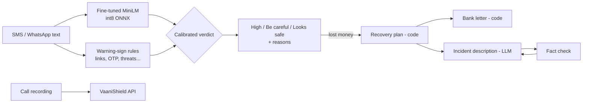

# Kavach (कवच) — AI scam-message detector and recovery agent

> *Kavach* = armour. Paste a suspicious SMS or WhatsApp message (English, हिंदी, मराठी, Hinglish) and Kavach
> tells you if it's a scam, **why**, and, if you've already lost money, **exactly what to do in the next hour**.

**Live demo:** {{WEB_URL}} · **API:** {{API_URL}}/docs · **Model:** [huggingface.co/shravan37/kavach-scam-classifier](https://huggingface.co/shravan37/kavach-scam-classifier) · Built by [Shravan Kasar](https://github.com/shravankasar37)

Part of an AI-safety suite: call recordings are checked by **[VaaniShield](https://github.com/shravankasar37/VaaniShield2.0)**
(voice-clone detection) and FIR complaints are drafted by **[NyayaSathi](https://github.com/shravankasar37/-NyayaSathi)**
(agentic legal aid).

---

## The problem

Fake KYC updates, "your electricity will be cut tonight", "your parcel is held", part-time "task" jobs and
"digital arrest" calls reach millions of Indians every day. Victims, often elderly or first-time smartphone users,
can't tell a fake from a real bank message, and after losing money they lose the most valuable hours not knowing
that a call to **1930** can freeze the money if it's made fast.

## What Kavach does

1. **Detects** the scam with a fine-tuned multilingual transformer (int8 ONNX, ~20 ms per message on CPU).
2. **Explains** it with deterministic warning signs: lookalike bank links (`sbi-kyc-verify.top` is not SBI),
   link shorteners, OTP/PIN requests, KYC threats, fee demands, prizes, job pay, APK/remote-access apps and
   "call this personal number", in English, Hindi and Hinglish.
3. **Recovers**: a plan decided by code (1930 first, cybercrime.gov.in, block UPI/card, change PINs, Sanchar
   Saathi report, RBI's 3-working-day zero-liability rule), a bank letter citing RBI circular
   DBR.No.Leg.BC.78/09.07.005/2017-18, and an incident description for the cybercrime portal drafted by an LLM
   **from the user's own facts only**, then fact-checked and rewritten if it added anything.



## Results (real data only)

There is **no public dataset of real Indian scam messages**, and most Kaggle "Indian scam" sets are LLM-generated.
So the headline numbers come only from **real** messages, held out before training:

| Test set (real messages) | Precision | Recall | F1 | False-positive rate |
|---|---|---|---|---|
| Model alone (int8 ONNX, deployed), 1,031 msgs: 128 smishing / 903 genuine | **0.992** | **0.969** | **0.980** | **0.11%** |
| Full Kavach verdict (model + warning signs) | — | **0.969** (124/128 flagged) | — | **0.22%** (2/903) |

Indian scams quoted **verbatim** in news (electricity disconnection ×3, job offer, India Post address update):
**5/5 rated High risk** (98–99.7%). Five messages is a spot check, not a benchmark
([`data/real/india_in_the_wild.jsonl`](data/real/india_in_the_wild.jsonl), with sources).

### Data decisions (the interesting part)

| Dataset | Used for | Why |
|---|---|---|
| SMS Smishing Collection (real, UCI-derived) | train + **real test** | Real messages; 20% stratified test split carved out first |
| `Ridham115/indian-scam-sms-synthetic-audited` | train | Synthetic but label-audited, 7 Indian language styles, includes hard negatives |
| India Cyber Scam Hinglish (10,000 rows) | train (743 rows) | **93% were template copies**: de-duplicated by text skeleton |
| "Indian Scam SMS 30k" | **excluded** | Label leakage: scam URLs literally contain "scam" (`whatsapp-scam-154.in`) |

### Engineering for a free 512 MB server

- Quantizing MatMul only left the 250,000-token embedding table in fp32 (**407 MB**). Quantizing the embedding
  `Gather` too brought the model to **118.5 MB** with identical test metrics.
- The HF `tokenizers` JSON for that vocabulary cost **+262 MB** of RAM; the original SentencePiece model with the
  XLM-R id convention costs **+41 MB** and gives **identical ids on all 1,034 test messages**. Service total:
  ~260 MB.
- Warning signs alone once flagged 11/903 genuine chats ("won't" matched "won", "yrs" matched "Rs"). Fixed
  patterns plus a calibrated policy (signals escalate only with 2+ signs or a strong one) cut that to 2/903 with
  no loss of recall, now locked in by regression tests.

## Run it

```bash
# API (http://localhost:8000/docs)
cd backend
python -m venv .venv && .venv/Scripts/pip install -r requirements.txt   # Windows; use bin/ on macOS/Linux
python -c "import urllib.request as u; [u.urlretrieve(f'https://huggingface.co/shravan37/kavach-scam-classifier/resolve/main/{f}', f'app/model/{f}') for f in ('kavach.int8.onnx','sentencepiece.bpe.model','metrics.json')]"
uvicorn app.main:app --port 8000
pytest tests

# Web (http://localhost:3000): needs GROQ_API_KEY and/or GEMINI_API_KEY for the recovery narrative
cd web && npm install && npm run dev
```

Reproduce training: `py -3.12 -I scripts/prepare_data.py`, then `kaggle kernels push -p training` (free T4 GPU),
then `training/shrink_onnx.py`.

## Limits and roadmap

The real test set is UK English SMS; Hindi and Marathi accuracy on real messages is not yet measured. Next: an
opt-in "report this scam" button that builds a consented, PII-masked real Indian dataset; OCR for screenshots;
and an Android share-sheet target so people can check a message without copying it. Kavach gives guidance, not
legal or financial advice.
